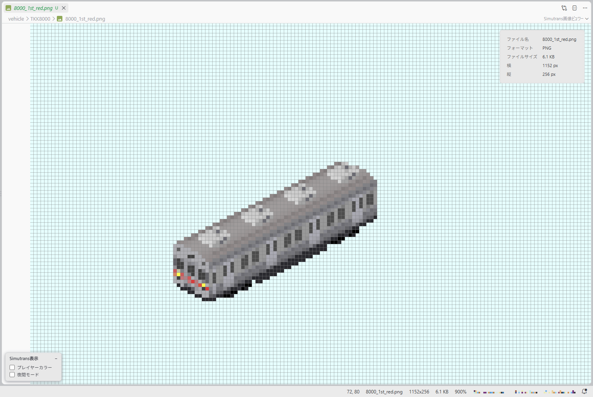
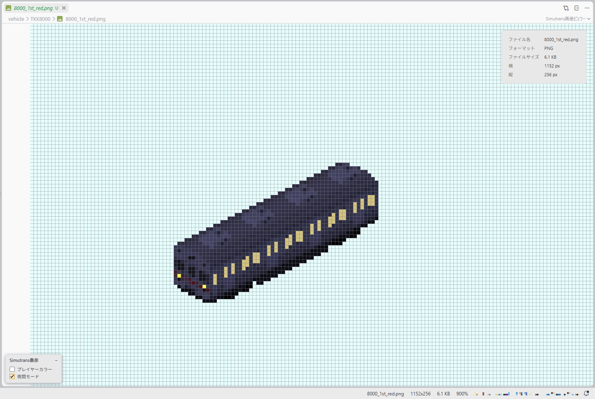
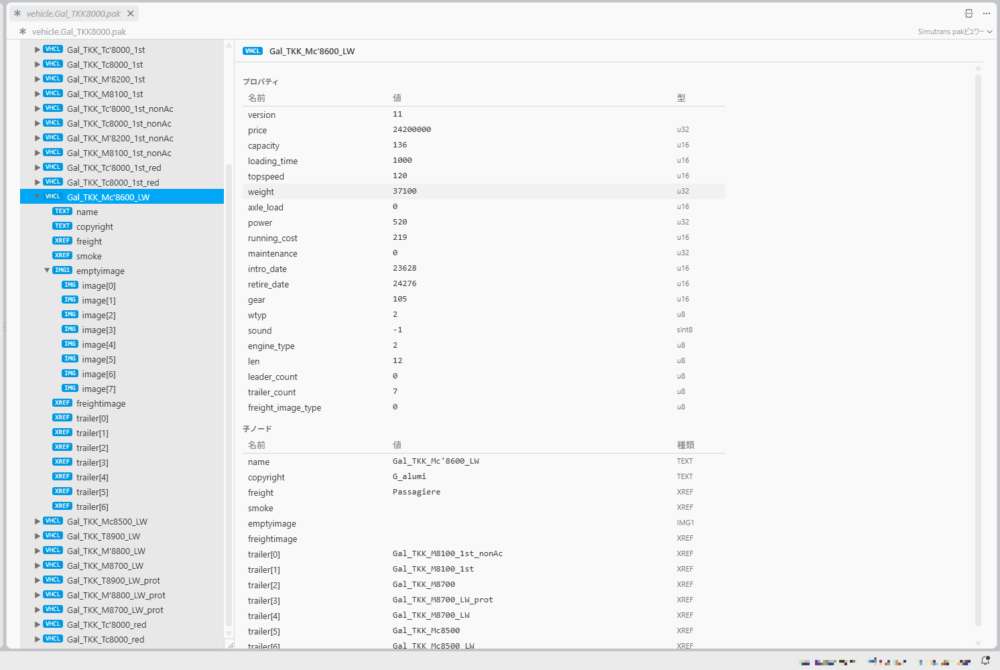
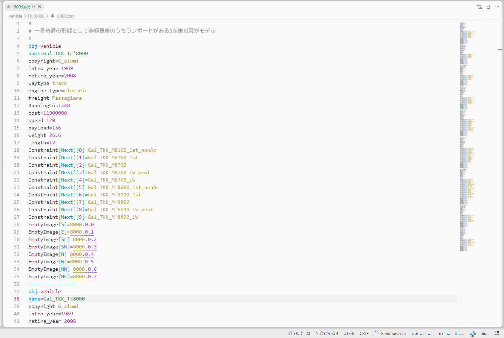
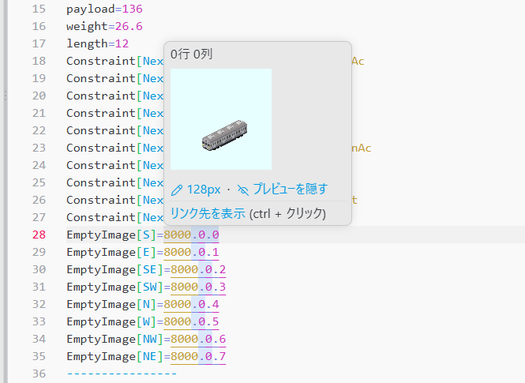
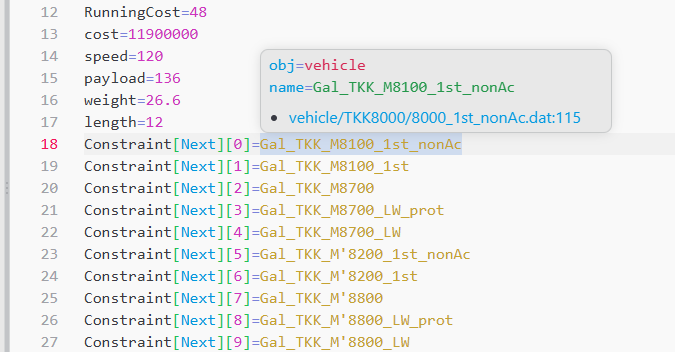

# Simutrans Addon Tools

[English](README.en.md)

Simutrans のアドオン開発に役立つ VS Code 拡張機能です。次の3つの機能が含まれています。

- [画像ビュワー](#画像ビュワー)  
  特別色(プレイヤーカラー・発光色)をゲーム内の見た目で確認

- [pakビュワー](#pakビュワー)  
  `.pak` ファイルの構造・値・画像を表示

- [datの言語サポート](#datの言語サポート)  
  シンタックスハイライト、画像プレビュー、名前参照へのジャンプ

表示言語は英語と日本語に対応しています。VS Code の表示言語に合わせて切り替わります。

## 画像ビュワー

次の形式に対応しています。

- PNG・JPEG・GIF・BMP・WebP・SVG・ICO
- APD(`.apd`)

### 操作

| 操作 | 内容 |
|---|---|
| ホイール | 拡大・縮小(最大12倍、ドットバイドット表示) |
| ドラッグ | 表示位置の移動 |
| `I` キー | ファイル情報(ファイル名・フォーマット・ファイルサイズ・横・縦)の表示 |
| 右クリック | 画像をクリップボードにコピー |

ステータスバーに、カーソル位置・画像サイズ・ファイルサイズ・倍率を表示します。

### Simutrans表示

左下の「Simutrans表示」パネルで、特別色をゲーム内の見た目に置き換えて表示できます。

- **プレイヤーカラー**: プレイヤーカラーを既定の会社色で表示
- **夜間モード**: ゲームで最も暗い夜と同じ明るさで表示し、発光色を夜間の色に置き換え

表示が変わるだけで、コピーされるのは元の画像です。

> [!NOTE]
> ほかの画像ビュワー拡張機能と併用している場合は、初めて開いたときにどちらを使うか選択を求められます。切り替えるには、エディタのタブを右クリックして「エディターを再度開くアプリケーションの選択」、エクスプローラーでファイルを右クリックして「ファイルを開くアプリケーションの選択…」、エディタ左上からSimutrans画像ビュワーを選択してください。

## pakビュワー

`.pak` ファイルの中身を読み取り専用で表示します。画面構成は次のとおりです。

- **左ペイン**: ノードツリー
- **右ペイン**: 選択したノードのプロパティ・画像・子ノード一覧

主な特徴は次のとおりです。

- Simutrans 本体の読み込み処理と同じ定義でフィールドを解析し、フィールド名付きで表示
- 画像ノードを画像として表示
- 未知のノードや、解析しきれなかったデータを警告表示

### 操作

キーボードだけでも操作できます。

| 操作 | 内容 |
|---|---|
| ↑ ↓ | 項目の移動 |
| ← → | ノードの展開・折りたたみ |
| Tab | ペインの切り替え |
| Ctrl+C | 選択中の値をコピー |
| 右クリック | コピーメニュー(名前・値・画像) |

次の2通りの形式で画像をコピーできます。

- 透明な部分を透明色(`#E7FFFF`)で塗ってコピー
- 透明な部分を透過させてコピー

## datの言語サポート

### シンタックスハイライト

`.dat` ファイルを「Simutrans dat」として色分け表示します。

### 画像プレビュー

`image[0][0]=building.0.1` のような画像指定では、次の操作ができます。

- **ホバー**: 指定した位置の画像を表示
- **Ctrl+クリック**: 画像ファイルを開く

ホバー内のボタンで、表示を切り替えられます。

- **pakサイズ**: 画像を切り出す1コマの大きさの変更(`cell_size=` がある場合はそちらを優先)
- **プレビューの表示・非表示**: 非表示にすると、画像の代わりに画像内の位置を表示

### 名前参照

`freight=` や `constraint[next][0]=` など、ほかのオブジェクトを指定している箇所では、次の操作ができます。

- **ホバー**: 参照先の種類・名前と、定義元ファイルへのリンクを表示
- **F12 / Ctrl+クリック**: 定義元(`name=`)へジャンプ
- **Shift+F12**: その名前の参照箇所を一覧表示(`name=` の値の上でも使用可)

検索対象は、ワークスペース内の `.dat` ファイルです。対応しているキーは次のとおりです。

| 参照元のキー | 参照先 |
|---|---|
| `freight`, `freightimagetype[n]`, `inputgood[n]`, `outputgood[n]` | `obj=good` |
| `constraint[prev][n]`, `constraint[next][n]` | `obj=vehicle` |
| `smoke` | `obj=smoke` |
| `way`(トンネル) | `obj=way` |
| `fields`, `fields[n]` | `obj=field` |

## 設定

| 設定 | 既定値 | 内容 |
|---|---|---|
| `simutrans-addon-tools.pakSize` | `128` | 画像プレビューのpakサイズ(`cell_size=` がある場合はそちらを優先) |
| `simutrans-addon-tools.pakSizeOverrides` | `{}` | datファイルごとのpakサイズ。ワークスペースフォルダからの相対パスを glob で指定(例: `{ "pak256/**": 256 }`) |
| `simutrans-addon-tools.imagePreview` | `true` | 画像指定のホバー時に画像を表示するかどうか |

ホバー内のボタンから変更する場合は、保存先を選択できます。

- **pakサイズ**: 「このファイルだけ」「ワークスペース」「ユーザー」
- **プレビューの表示・非表示**: 「ワークスペース」「ユーザー」

## 動作環境

- VS Code 1.117 以降

## クレジット

- APD ファイルの読み込み: [apd-js-tools](https://github.com/G-alumi/apd-js-tools)(MIT)
  - Azel 氏の [apdtool](https://gitlab.com/azelpg/apdtool)(MIT)をもとに作成した、AzPainter の `.apd` ファイルを読み込むライブラリ

## ライセンス

[MIT](LICENSE)
